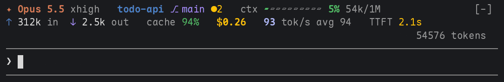
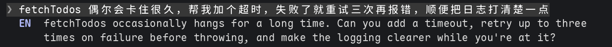
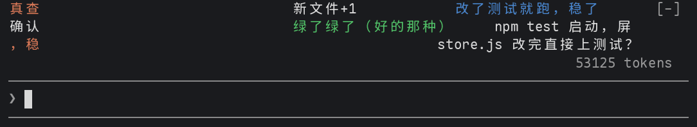
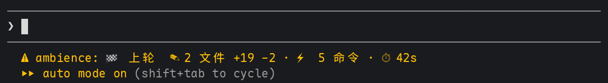

# claude-mods

[English](README.md) | 简体中文

[Claude Code](https://code.claude.com) 的 mod：用 function hooks 写的插件，改的是 Claude Code 自己的界面和行为。每个 mod 一个目录，各有自己的 `.claude-plugin/plugin.json`；整个仓库是一个名为 `kadaliao` 的插件市场，每个 mod 可以单独安装。

| Mod | 作用 |
| --- | --- |
| [statusline](statusline/) | 输入框上方两行状态栏：模型、目录、git 分支、上下文窗口、读写 token、缓存率、API 计价、token 速率和 TTFT<br> |
| [prompt-en](prompt-en/) | 每条 prompt 下方一行英文：其他语言给译文，英文给纠错或别的说法；长 prompt 给精简版，粘贴的代码折叠成标签；附带生词本（`/vocab`），复习它教过的说法<br> |
| [danmaku](danmaku/) | Claude 干活时输入框上方几条轨道飘 B 站风格弹幕，实时吐槽它在干什么：`rm -rf`、测试挂了这类事马上有反应，其余由小模型每隔几秒写几句<br> |
| [ambience](ambience/) | 给 Claude 的动作配音效（跑命令咔哒、改文件啵、测试通过放号角、失败放悲伤长号、一轮结束响铃），长任务结束发系统通知，输入框下方实时显示本轮战报<br> |

安装某个 mod，在 Claude Code 终端会话的输入框里输入：

```
/plugin install <mod> --marketplace kadaliao/claude-mods
```

或者在 shell 里：

```bash
claude plugin marketplace add kadaliao/claude-mods
claude plugin install <mod>@kadaliao
```

每个目录的 README 说明 mod 的作用、原理和限制。mod 是 Claude Code 的 early access API，版本之间可能变化。

## 更新

已安装的 mod 跑的是安装时拷贝的那一份。要拿到新提交：

```bash
claude plugin marketplace update kadaliao
claude plugin update <mod>@kadaliao
```

然后在已打开的会话里运行 `/reload-plugins`，或者开一个新会话。

## 本地开发

```bash
git clone git@github.com:kadaliao/claude-mods.git ~/workspace/claude-mods
claude --plugin-dir ~/workspace/claude-mods/statusline
```

`--plugin-dir` 让这个会话加载工作副本，保存文件时自动重新加载。如果不想和 GitHub 装的那份同时运行，先卸载它（`claude plugin uninstall <mod>@kadaliao`）。

许可证：MIT（License: MIT）
