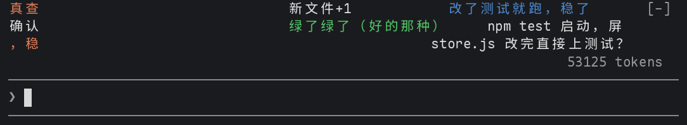

# danmaku

English | [简体中文](README.zh-CN.md)

Bilibili-style bullet comments (danmaku) that fly right to left across a few lanes above the prompt
while Claude works, heckling what it does: "前方高能！！" when it runs `rm -rf`, "红了红了" when a
test fails, "这波操作有点东西" when a small model finds the moment worth a quip.

```
        前排            666
   又在 grep 了                     前方高能！！
                 这波操作有点东西
> _
```



Two more styles bring in the philosophers:

- **philosophy**: instead of heckles, real lines from philosophers of many schools, each with who
  said it and their school. A failing test gets "One must imagine Sisyphus happy. — Camus
  (Absurdism)"; `rm -rf` gets "Originally there is not a single thing; where could dust alight?
  — Huineng (Zen)".
- **philosopher-heckle**: a crowd of philosophers in the chat, each heckling Claude from their own
  school's point of view. A failing test: "Popper (Critical rationalism): Falsified!
  Congratulations, that's science." An install: "William of Ockham (Scholasticism): Do not multiply
  dependencies beyond necessity."

```
   A journey of a thousand miles begins with a single step. — Laozi (Taoism)       philosophy
              One must imagine Sisyphus happy. — Camus (Absurdism)

   Diogenes (Cynicism): I live in a barrel. You need all these packages?         philosopher-heckle
         Nietzsche (Existentialism): When you grep into the abyss, the abyss greps into you.
> _
```

Comments come in Chinese, English, or both.

The lanes take three rows, only while Claude works and for about 12 seconds after the last
comment; then they fold away and the prompt has its room back. If another mod draws above the
prompt too (the [statusline](../statusline/) band, say), the lanes go above it. statusline
before 0.1.1 takes that space whole and hides the lanes: update it, and `/danmaku` tells you
when something is in the way.

The comments are in Chinese by default, as on Bilibili; the `language` option makes them
English, or both.

## Install

At the prompt of a terminal session:

```
/plugin install danmaku --marketplace kadaliao/claude-mods
```

Or from a shell:

```bash
claude plugin marketplace add kadaliao/claude-mods
claude plugin install danmaku@kadaliao
```

Then type `/danmaku` to switch it on.

## Use

| Command | What it does |
| --- | --- |
| `/danmaku` | Switches it on (one comment flies by to show where), or off if it is on |
| `/danmaku on` / `/danmaku off` | Switches it on or off |
| `/danmaku <text>` | Sends a comment of your own, bold and underlined |

Whether it is on is remembered: a new session starts with it on again. `ctrl+x ctrl+a` (or the
`[-]` beside the band) collapses everything drawn above the prompt.

## Styles and languages

Set `style` in `/config`: `heckle` for the Bilibili heckles (the default), `philosophy` for the
philosophers' lines, `philosopher-heckle` for the philosophers heckling. Set `language` to
`chinese`, `english` or `bilingual`.

| `language` | `philosophy` | `philosopher-heckle` |
| --- | --- | --- |
| `chinese` | 应当想象西西弗斯是幸福的 ——加缪（荒诞主义） | 波普尔（批判理性主义）：被证伪了！恭喜，这才叫科学 |
| `english` | One must imagine Sisyphus happy. — Camus (Absurdism) | Popper (Critical rationalism): Falsified! Congratulations, that's science. |
| `bilingual` | 应当想象西西弗斯是幸福的 / One must imagine Sisyphus happy. —— 加缪 Camus（荒诞主义 Absurdism） | 波普尔 Popper（批判理性主义 Critical rationalism）：被证伪了！恭喜，这才叫科学 / Falsified! Congratulations, that's science. |

- **A line is quoted; a heckle is made up**, and they look different: a line has "— who (school)"
  after it, a philosopher's heckle has "who (school):" before it, like a name in the chat. Both
  draw the name dim.
- **philosophy**: the instant reactions come from a table of lines picked by hand, each with a
  known source, across Confucianism, Taoism, Mohism, Legalism, the School of Names, Buddhism, Zen,
  the School of Mind, the Pre-Socratics, Classical Greek philosophy, Stoicism, Epicureanism,
  Scholasticism, Rationalism, Empiricism, German Idealism, Existentialism, Absurdism,
  Phenomenology, Pragmatism, Analytic philosophy and Marxism. The model quotes one line a request
  (two when a lot happened).
- **philosopher-heckle**: the instant reactions have a table too, each philosopher heckling with
  their own big idea (Diogenes finds the packages excessive, Hume doubts the tests will be green
  next time, Heraclitus says you cannot push the same commit twice). The model writes one or two a
  request, each by a different philosopher, in their own voice.
- Both suggest three schools at random to look in first on each request, so a small model does not
  keep coming back to the same few names, and pass the latest comments so it does not repeat them.
- A comment with a name is longer and is read, so it crosses more slowly: about 14 seconds rather
  than 9, and a third longer again in both languages.
- The heckles follow `language` too: `english` gives English stream-chat comments ("here it
  comes!!", "red red red"), `bilingual` each Chinese comment with an English one after it. Under
  `english`, `/danmaku` answers in English.

## How it works

- **Instant reactions.** A table of reactions answers some things at once, with no model call: a
  dangerous command (`rm -rf`, `sudo`, `--force`, `reset --hard`), a test command passing or
  failing, `git push` and `git commit`, a subagent being spawned, the turn starting, ending or
  being interrupted. Frequent things (reads, edits, plain commands) get a reaction only now and then.
- **Model comments.** Each tool call, your prompt, and the end of the turn go into a queue as one
  short line ("Claude 跑命令：npm test（失败了）"). Once three are queued, or three seconds after the
  first, the mod asks the model for one to three comments, passing the
  last ten comments so it does not repeat them. One request at a time, and at most one every 4
  seconds (the `density` option: 8s, 4s or 2s).
- **The lanes.** Every comment takes about nine seconds to cross, so a longer one moves faster, as
  on Bilibili. A new comment takes the topmost lane where it has room and will not catch the one
  ahead; with no lane free it waits. The lanes move on the terminal's own frame clock, ten frames a
  second, so the rest of the band is not redrawn for each frame.

## Options

| Option | Values | Default |
| --- | --- | --- |
| `style` | `heckle` (Bilibili heckles), `philosophy` (philosophers' lines), `philosopher-heckle` (philosophers heckling) | `heckle` |
| `language` | `chinese`, `english`, `bilingual` | `chinese` |
| `model` | `haiku`, `sonnet` | `haiku` |
| `density` | `low` (a request every 8s at most), `normal` (4s), `high` (2s) | `normal` |
| `lanes` | `2`, `3`, `4`: rows the comments fly in | `3` |

Set them in `/config`, or in `~/.claude/settings.json` under `pluginConfigs.danmaku`. In a short
terminal the lanes give way: they keep three rows of the band for other mods, and leave out a lane
rather than push those off.

## Limits

- What goes to the model: the first 80 characters of your prompt, the first 60 of each command,
  file names (not their contents), search patterns, and the first 120 characters of Claude's
  answer. It is sent on the session's own credentials, like any of Claude Code's requests, and
  billed to them. With `haiku` and the default density it is a small amount; no request is made
  while it is off, or where nothing draws the band (a `claude -p` run).
- Comments are about what happened, not always funny, and sometimes repeat.
- In the philosophy style the table's lines are checked against their sources. The model is told
  to quote only real lines, but a small model now and then gets a name, a school or a translation
  wrong: take them as fun, not as citations. The philosophers' heckles are made up, not quotes.
- Drawn on the terminal and the desktop app; a survey takes the band while it shows. Mods
  (function hooks) are an early-access API of Claude Code and may change between releases. Built
  and tested on Claude Code 2.1.322.
- Version 0.1 drew in a side pane. Updating closes that pane.

## Development

```bash
claude --plugin-dir ~/workspace/claude-mods/danmaku   # a session that loads the working copy
claude plugin validate ~/workspace/claude-mods/danmaku
claude plugin test ~/workspace/claude-mods/danmaku
```

License: MIT
