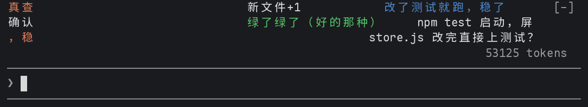

# danmaku

[English](README.md) | 简体中文

Claude 干活的时候，输入框上方几条轨道里飘 B 站风格的弹幕，从右往左飞，吐槽它在干什么：跑 `rm -rf` 时来一句"前方高能！！"，测试挂了来一句"红了红了"，小模型觉得有梗的时候来一句"这波操作有点东西"。

```
        前排            666
   又在 grep 了                     前方高能！！
                 这波操作有点东西
> _
```



还有两种哲学风格：

- **哲学名言**：不吐槽，改飘各家哲学的原话，后面带上是谁说的、哪个流派。测试挂了来一句"应当想象西西弗斯是幸福的 ——加缪（荒诞主义）"，`rm -rf` 时来一句"本来无一物，何处惹尘埃 ——慧能（禅宗）"。
- **哲学家吐槽**：一群哲学家挤在弹幕区，各自从自己流派的角度吐槽 Claude。测试挂了，"波普尔（批判理性主义）：被证伪了！恭喜，这才叫科学"；装依赖，"奥卡姆的威廉（经院哲学）：如无必要，勿增依赖"。

```
   千里之行，始于足下 ——老子（道家）                      哲学名言
              应当想象西西弗斯是幸福的 ——加缪（荒诞主义）

   第欧根尼（犬儒学派）：我住桶里都够用，你要装这么多包？      哲学家吐槽
          尼采（存在主义）：你 grep 深渊时，深渊也在 grep 你
> _
```

弹幕可以是中文、英文，或中英双语。

弹幕轨道占三行，只在 Claude 干活时，以及最后一条弹幕之后大约 12 秒内显示，之后自动收起，输入框上方的空间还给你。如果还有别的 mod 也画在输入框上方（比如 [statusline](../statusline/) 的状态栏），弹幕在它上面。0.1.1 之前的 statusline 会把这块整个占掉，弹幕就看不到了，请先更新它；被挡住时 `/danmaku` 会提示。

## 安装

在终端会话的输入框里：

```
/plugin install danmaku --marketplace kadaliao/claude-mods
```

或者在 shell 里：

```bash
claude plugin marketplace add kadaliao/claude-mods
claude plugin install danmaku@kadaliao
```

装好后输入 `/danmaku` 打开弹幕。

## 用法

| 命令 | 作用 |
| --- | --- |
| `/danmaku` | 打开弹幕（马上飘过一条，让你知道在哪）；已经开着就关掉 |
| `/danmaku on` / `/danmaku off` | 打开 / 关闭 |
| `/danmaku <文字>` | 发一条自己的弹幕（加粗带下划线） |

开关状态会记住，下次开会话时自动打开。`ctrl+x ctrl+a`（或者右边的 `[-]`）可以把输入框上方画的东西整个收起来。

## 风格和语言

在 `/config` 里改 `style`：`heckle` 是 B 站吐槽（默认），`philosophy` 是哲学名言，`philosopher-heckle` 是哲学家吐槽。`language` 选 `chinese`、`english` 或 `bilingual`（中英双语）。

| `language` | 哲学名言 | 哲学家吐槽 |
| --- | --- | --- |
| `chinese` | 应当想象西西弗斯是幸福的 ——加缪（荒诞主义） | 波普尔（批判理性主义）：被证伪了！恭喜，这才叫科学 |
| `english` | One must imagine Sisyphus happy. — Camus (Absurdism) | Popper (Critical rationalism): Falsified! Congratulations, that's science. |
| `bilingual` | 应当想象西西弗斯是幸福的 / One must imagine Sisyphus happy. —— 加缪 Camus（荒诞主义 Absurdism） | 波普尔 Popper（批判理性主义 Critical rationalism）：被证伪了！恭喜，这才叫科学 / Falsified! Congratulations, that's science. |

- **名言是引的，吐槽是编的**，两者一眼能分开：名言的"——人名（流派）"放在句子后面，哲学家吐槽的"人名（流派）："放在前面，像弹幕的用户名。两种都用暗色。
- **哲学名言**：即时反应用一张挑过的语录表，每句都有可靠出处，覆盖儒、道、墨、法、名家、佛家、禅宗、心学、前苏格拉底、古希腊、斯多葛、伊壁鸠鲁、经院哲学、理性主义、经验主义、德国古典哲学、存在主义、荒诞主义、现象学、实用主义、分析哲学、马克思主义。模型每次引 1 句（事情多时最多 2 句）。
- **哲学家吐槽**：即时反应同样有一张表，每位哲学家用自己的招牌观点吐槽（第欧根尼嫌包多，休谟怀疑下次测试还能不能绿，赫拉克利特说人不能两次 push 同一个 commit）。模型每次写 1 到 2 条，每条换一位哲学家，用他的口吻说。
- 两种哲学风格都会每次随机建议先从三个流派里找，免得小模型老回到同几位；请求里带上最近的弹幕，避免重复。
- 带人名的弹幕更长、要读，所以飞得慢：大约 14 秒飞完全程（B 站吐槽是 9 秒）。双语再慢三成。
- B 站吐槽也跟着 `language` 走：`english` 换成英文直播聊天风格的弹幕（"here it comes!!"、"red red red"），`bilingual` 每条中文后面跟一句英文。`/danmaku` 的回复在 `english` 下也是英文。

## 原理

- **即时反应**：有些事情查表马上发弹幕，不调模型。包括危险命令（`rm -rf`、`sudo`、`--force`、`reset --hard`）、测试命令通过或失败、`git push` 和 `git commit`、派出子代理，以及回合开始、结束或被打断。读文件、改文件、普通命令这类太频繁的事，只偶尔来一条。
- **模型弹幕**：每次工具调用、你的提问和回合结束，都会压成一行短描述放进队列，比如"Claude 跑命令：npm test（失败了）"。攒到 3 条，或第一条进队满 3 秒，就让模型写 1 到 3 条弹幕。请求里带上最近 10 条弹幕，避免重复。同一时间只发一个请求，两次请求至少隔 4 秒（由 `density` 选项决定：8 秒、4 秒或 2 秒）。
- **轨道**：每条弹幕大约 9 秒飞完全程，所以长弹幕跑得快一些，跟 B 站一样。新弹幕放进最靠上、有空位、而且不会追上前一条的轨道；所有轨道都满时先排队。弹幕按终端自己的帧时钟移动，每秒 10 帧，不会因为每一帧都把整个输入框上方区域重画一遍。

## 选项

| 选项 | 取值 | 默认 |
| --- | --- | --- |
| `style` | `heckle`（B 站吐槽）、`philosophy`（哲学名言）、`philosopher-heckle`（哲学家吐槽） | `heckle` |
| `language` | `chinese`、`english`、`bilingual`（中英双语） | `chinese` |
| `model` | `haiku`、`sonnet` | `haiku` |
| `density` | `low`（最多 8 秒请求一次）、`normal`（4 秒）、`high`（2 秒） | `normal` |
| `lanes` | `2`、`3`、`4`：弹幕轨道的行数 | `3` |

在 `/config` 里改，或者写在 `~/.claude/settings.json` 的 `pluginConfigs.danmaku` 下。终端很矮时轨道会让位：给别的 mod 留出三行，宁可少一条轨道也不把它们挤出去。

## 限制

- 发给模型的内容：你提问的前 80 个字、每条命令的前 60 个字、文件名（不含文件内容）、搜索关键词，以及 Claude 回答的前 120 个字。用的是会话本身的账号和额度，跟 Claude Code 自己的请求一样计费。用 `haiku` 加默认密度，花费很少。弹幕关着，或者没有界面显示（比如 `claude -p`）时不发请求。
- 弹幕只是围绕刚发生的事起哄，不保证每条都好笑，偶尔会重复。
- 哲学名言里，即时反应的句子都核对过出处；模型引的句子要它只引真实原话，但小模型偶尔会记错人名、流派或译法，当成好玩的东西看，别拿去引用。哲学家吐槽本来就是编的，不是原话。
- 在终端和桌面端绘制；有调查问卷时让位给问卷。mod（function hooks）是 Claude Code 的 early access API，版本之间可能变化。在 Claude Code 2.1.322 上构建和测试。
- 0.1 版画在侧边面板里，更新后会关掉那个面板。

## 开发

```bash
claude --plugin-dir ~/workspace/claude-mods/danmaku   # 加载工作副本的会话
claude plugin validate ~/workspace/claude-mods/danmaku
claude plugin test ~/workspace/claude-mods/danmaku
```

许可证：MIT（License: MIT）
