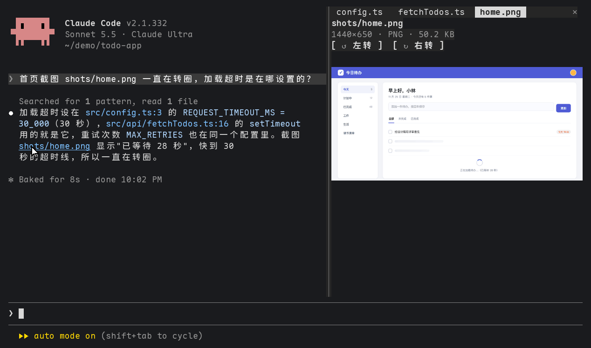

# open-file

English | [简体中文](README.zh-CN.md)

Click a file path in Claude's replies to open the file beside the conversation. The paths Claude
writes (`src/app.ts:42`, `README.md`, `~/notes/todo.txt`, an absolute path) become links; a click
opens the file in a pane on the right, highlighted, with line numbers, scrolled to the line the
path names. A picture opens as large as the pane holds it, with buttons to turn it. Each file gets a
tab of its own.

```
⏺ Fixed it in src/app.ts:42 and         │ register.tsx   app.ts                        ✕
  updated README.md.                    │ src/app.ts:42
                                        │ 120 行
                                        │
                                        │ 41 // the line before
                                        │ 42 const fixed = true        ← highlighted
                                        │ 43 // the line after
```



## Install

At the prompt of a terminal session:

```
/plugin install open-file --marketplace kadaliao/claude-mods
```

Or from a shell:

```bash
claude plugin marketplace add kadaliao/claude-mods
claude plugin install open-file@kadaliao
```

It needs fullscreen rendering: type `/tui fullscreen` once if you are not on it. The main screen
reports no clicks to a mod, and opens a pane above the prompt rather than beside the conversation.

## Use

- **Which paths**: relative to the session's folder, absolute, or starting with `~/`; in plain
  text, in backticks, or as a markdown link (`[app](src/app.ts#L42)`). A line number after the
  path, `:42`, `:42:7`, `:42-50` or `#L42`, scrolls to that line. A path glued to Chinese text
  is still found (`看一下src/app.ts文件`), and so is one with spaces or Chinese in it
  (`/Users/me/Desktop/截图 2026-11-25.png`): the mod reads it on past them and links the
  longest reading that is a file.
- **Only files that exist** become links. A path to a folder or to nothing stays plain text, and so
  does anything in a fenced code block or a URL.
- **Click** a path: its file opens in a tab of its own. Click an open file's path again and its tab
  comes forward at the line clicked. Two files with the same name are told apart by their folder in
  the tab (`danmaku/README.md`).
- **Tabs**: click one to show it, or its `✕` to close it. Escape at an empty prompt closes the tab
  shown. Up to 8 at once: a ninth file closes the one opened first.
- **Scroll**: the mouse wheel over the pane, or click into it, then the arrow keys and Page Up / Page
  Down.
- **ctrl- or alt-click** a path to open it in your system's default app instead.
- A file Claude edits (Edit, Write) while its tab is open is drawn again with the change.

## Pictures

A path to a picture (`shot.png`, `photo.jpg`, `~/Downloads/a.heic`) opens the picture in its tab
in place of its bytes:

```
                                        │ assets/shot.png
                                        │ 2880×1800 · PNG · 1.2 MB · 向右转了 90°
                                        │ [ ↺ 左转 ]  [ ↻ 右转 ]  [ 还原 ]
                                        │
                                        │   (the picture, fitted to the pane)
```

- **Size**: as large as the pane holds it whole; a small picture is drawn at most twice its own
  size.
- **Turning**: `↺ 左转` and `↻ 右转` turn it a quarter, `还原` sets it back. With the pane clicked
  into, `l`, `r` and `0` do the same. Only the view turns: the file is never written. A tab keeps
  its turn when you click the path again.
- **Photos** are set upright as their EXIF orientation says, as a photo viewer does.
- **Formats**: PNG and JPEG are decoded by the mod itself. GIF (its first frame), WebP, HEIC,
  TIFF, BMP and the rest go through macOS's `sips`, which makes a PNG of them in the temporary
  folder; the mod reads it and removes it. Without `sips` (not on a Mac), those say they cannot
  be shown. SVG opens as text.
- The terminal must draw pictures: kitty, Ghostty, or iTerm2 3.5 and later, as for
  [peek](../peek/). Elsewhere the tab shows the picture's name and size in its place.

## Terminals

The links are the terminal's own hyperlinks. Where Claude Code does not know the terminal draws
them (herdr, for one), it writes each link as its text followed by the URL, and only a click on the
URL part opens it. So the mod sets `FORCE_HYPERLINK=1` when a session starts, unless you set it
yourself, and the links then show as the path alone. Commands Claude runs inherit the variable, and
a few command-line tools then print their own links as escape codes in their output. Set
`FORCE_HYPERLINK=0` before Claude Code starts to keep it off.

## How it works

- Each block of a reply passes the mod before it is drawn. The mod finds what looks like a path,
  asks the file system whether it is a file, and draws the block as Claude Code draws a reply, with
  those paths as `file:` links whose clicks it answers. A block with no file in it is left to
  Claude Code.
- The pane is one per file, its id a hash of the path, so the same file is always the same tab.
  The file is read when its tab is drawn and again when it changes.
- A picture is decoded once per version of the file (a 12-megapixel photo takes under half a
  second), kept no larger than 2048 pixels a side, then shrunk to the pane and turned for each
  drawing. The PNG and JPEG decoders are [peek](../peek/)'s, copied, so each mod installs on its
  own.
- Nothing leaves your machine and no model is called.

## Limits

- A picture over 40 MB is not read whole: it goes through `sips`, which shrinks it first. Pixels
  past 2048 a side are not kept, which is more than any pane shows.
- Only Claude's replies: paths in a tool's row (`Read(src/app.ts)`) or in your own prompt are not
  links.
- In plain text a path with spaces or Chinese in it is found when it starts with a folder in
  ASCII (`/Users/…`, `~/…`, `docs/…`); one that starts with Chinese (`截图/a.png`) is found only
  in backticks or as a markdown link. Its reading stops at Chinese punctuation (`，。；`) and at two
  spaces.
- Claude Code has no way for a mod to bring an open tab forward, so clicking an open file closes
  its tab and opens it again, as the last tab.
- A large file shows about 90,000 characters of lines around the line clicked, and a file over 2 MB
  is read from its start only. A binary file shows a line saying so.
- Drawn on the terminal only. Mods (function hooks) are an early-access API of Claude Code and may
  change between releases. Built and tested on Claude Code 2.1.332.

## Development

```bash
claude --plugin-dir ~/workspace/claude-mods/open-file   # a session that loads the working copy
claude plugin validate ~/workspace/claude-mods/open-file
claude plugin test ~/workspace/claude-mods/open-file
```

License: MIT
