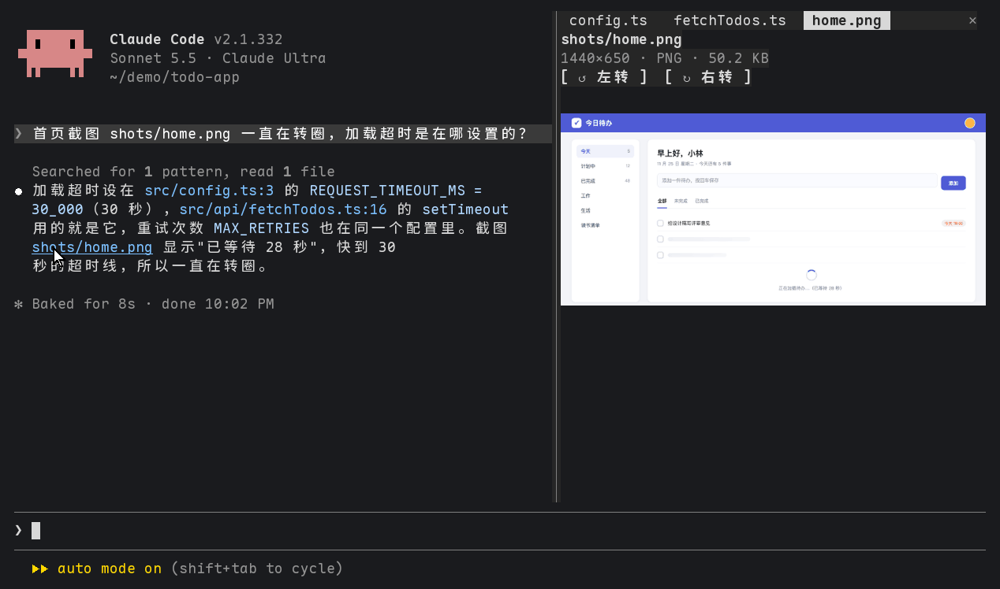

# open-file

[English](README.md) | 简体中文

点 Claude 回复里的文件路径，文件就在对话旁边打开。Claude 写出的路径（`src/app.ts:42`、`README.md`、`~/notes/todo.txt`、绝对路径）会变成链接；点一下，文件在右侧面板打开，带语法高亮和行号，并滚到路径指明的那一行。图片则缩放到面板能放下的大小显示，带旋转按钮。每个文件一个标签页。

```
⏺ Fixed it in src/app.ts:42 and         │ register.tsx   app.ts                        ✕
  updated README.md.                    │ src/app.ts:42
                                        │ 120 行
                                        │
                                        │ 41 // 前一行
                                        │ 42 const fixed = true        ← 高亮
                                        │ 43 // 后一行
```



## 安装

在终端会话的输入框里：

```
/plugin install open-file --marketplace kadaliao/claude-mods
```

或者在 shell 里：

```bash
claude plugin marketplace add kadaliao/claude-mods
claude plugin install open-file@kadaliao
```

需要全屏渲染：还没开的话输入一次 `/tui fullscreen`。普通模式下点击不会交给 mod，面板也只能开在输入框上方，不在对话旁边。

## 用法

- **认哪些路径**：相对会话目录的路径、绝对路径、`~/` 开头的路径；写在正文里、反引号里，或者写成 markdown 链接（`[app](src/app.ts#L42)`）都行。路径后面跟行号（`:42`、`:42:7`、`:42-50`、`#L42`）会滚到那一行。和中文连着写也认得出（`看一下src/app.ts文件`）；路径中间有空格或中文也认得出（`/Users/me/Desktop/截图 2026-11-25.png`）：mod 会越过空格和中文往后读，取最长的那个确实存在的文件。
- **只有存在的文件**才变成链接。指向文件夹或者不存在的路径保持原样，代码块里的路径和网址也不动。
- **点击**路径：文件在自己的标签页里打开。再点一个已经打开的文件，它的标签页会回到前面，并滚到这次点的行。两个同名文件在标签上带上文件夹名区分（`danmaku/README.md`）。
- **标签页**：点标签切换，点 `✕` 关闭；输入框为空时按 Esc 关掉当前标签。最多同时开 8 个，开第 9 个会关掉最早打开的那个。
- **滚动**：鼠标滚轮直接滚；或者点进面板，用方向键、Page Up / Page Down。
- 按住 **ctrl 或 alt 点击**路径，改用系统默认程序打开。
- 标签页开着时，Claude 用 Edit、Write 改了这个文件，面板会重新画出改动后的内容。

## 图片

指向图片的路径（`shot.png`、`photo.jpg`、`~/Downloads/a.heic`）在标签页里显示图片本身，而不是字节：

```
                                        │ assets/shot.png
                                        │ 2880×1800 · PNG · 1.2 MB · 向右转了 90°
                                        │ [ ↺ 左转 ]  [ ↻ 右转 ]  [ 还原 ]
                                        │
                                        │   （图片，缩放到面板大小）
```

- **大小**：缩放到面板能完整放下的大小；小图最多放大到原尺寸的两倍。
- **旋转**：`↺ 左转`、`↻ 右转` 每次转 90°，`还原` 转回原样。点进面板后按 `l`、`r`、`0` 也一样。只转显示，不改文件。再点一次路径，标签页保留转过的角度。
- **照片**按 EXIF 里的方向摆正，和看图软件一样。
- **格式**：PNG 和 JPEG 由 mod 自己解码。GIF（第一帧）、WebP、HEIC、TIFF、BMP 等交给 macOS 的 `sips` 在临时目录里转成 PNG，mod 读完就删掉。没有 `sips`（不是 Mac）时，这些格式会提示显示不了。SVG 按文本打开。
- 终端要能画图片：kitty、Ghostty，或者 iTerm2 3.5 以上，和 [peek](../peek/) 一样。其他终端在图片的位置显示文件名和尺寸。

## 终端

链接用的是终端自己的超链接。Claude Code 不认识的终端（比如 herdr）会被当成不支持超链接，每个链接画成“文字 (网址)”，只有点括号里的网址才有用。所以 mod 在会话启动时设置 `FORCE_HYPERLINK=1`（你自己设过就不动），链接就只显示路径。Claude 跑的命令会继承这个变量，个别命令行工具会因此在输出里带上链接的转义符。不想要的话，在 Claude Code 启动前设 `FORCE_HYPERLINK=0`。

## 原理

- 回复的每一段在画出来之前先经过 mod。mod 找出像路径的文字，问文件系统它是不是文件，再按 Claude Code 画回复的方式把这一段画出来，其中的文件路径换成 `file:` 链接，点击由 mod 处理。没有文件的段落原样交给 Claude Code。
- 每个文件一个面板，面板 id 是路径的哈希，所以同一个文件总是同一个标签页。标签页画出时读文件，文件变了再读。
- 图片每个版本只解码一次（1200 万像素的照片不到半秒），保留的像素不超过每边 2048，每次画的时候再缩到面板大小并旋转。PNG 和 JPEG 解码器是从 [peek](../peek/) 复制过来的，两个 mod 可以各自单独安装。
- 不联网，也不调用模型。

## 限制

- 超过 40 MB 的图片不整个读进来，交给 `sips` 先缩小。每边超过 2048 的像素不保留，这已经比任何面板显示得多。
- 只认 Claude 的回复：工具调用那一行（`Read(src/app.ts)`）和你自己输入的消息里的路径不会变成链接。
- 正文里带空格或中文的路径，要以 ASCII 的文件夹开头（`/Users/…`、`~/…`、`docs/…`）才认；以中文开头的（`截图/a.png`）只有写在反引号里或 markdown 链接里才认。往后读到中文标点（`，。；`）或两个连续空格为止。
- Claude Code 没给 mod 提供把已打开标签页切到前面的方法，所以再点已打开的文件时，会先关掉它的标签页再重开，它就成了最后一个。
- 大文件只显示点击行附近约 90,000 个字符的内容；超过 2 MB 的文件只读开头 2 MB。二进制文件只显示一行说明。
- 只在终端里画。mod（function hooks）是 Claude Code 的 early access API，版本之间可能变化。在 Claude Code 2.1.332 上开发和测试。

## 开发

```bash
claude --plugin-dir ~/workspace/claude-mods/open-file   # 加载工作副本的会话
claude plugin validate ~/workspace/claude-mods/open-file
claude plugin test ~/workspace/claude-mods/open-file
```

许可证：MIT
