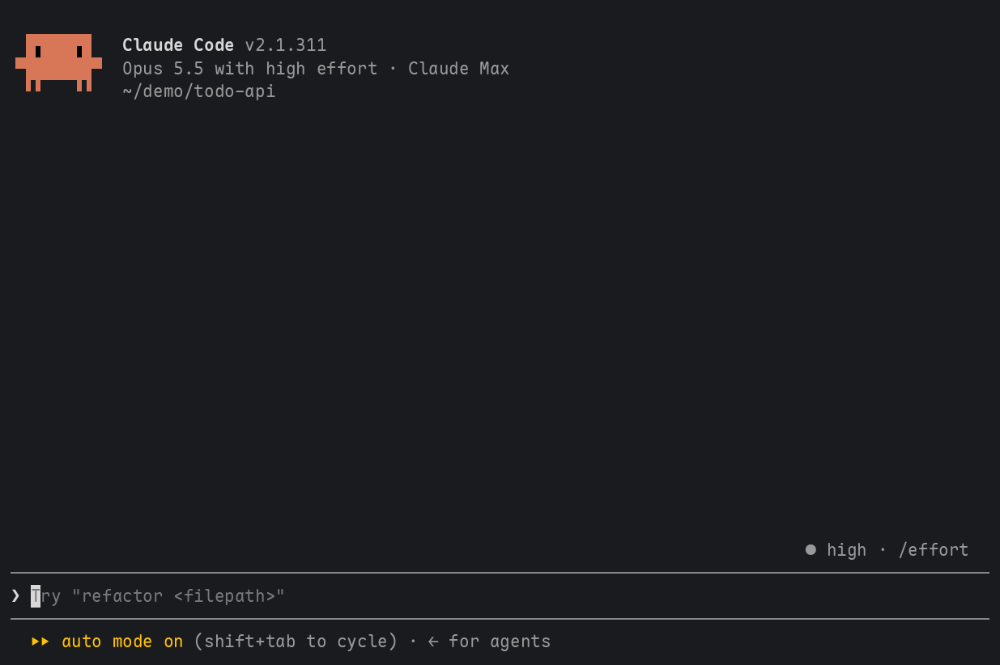
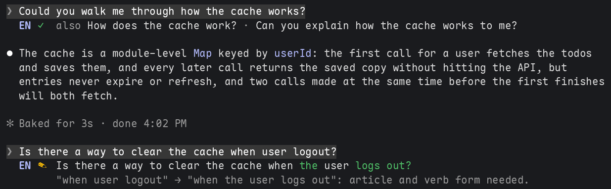
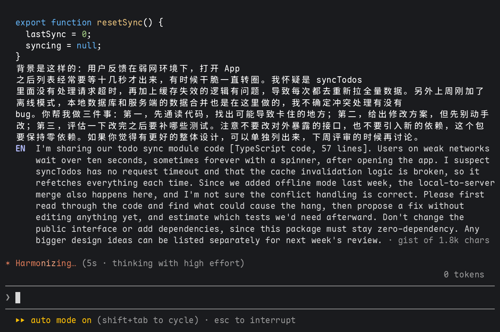
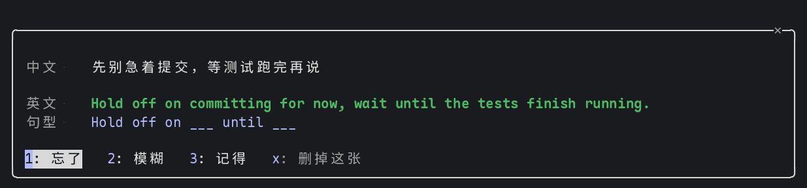
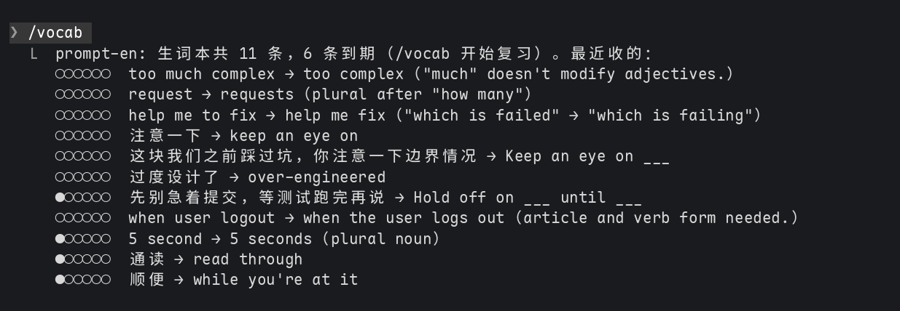

# prompt-en

English | [简体中文](README.zh-CN.md)

A line of English under each prompt you send, drawn in the transcript. It scrolls with the
conversation and takes no fixed space on screen.



**Written in another language**, the prompt gets its English:

```
> 我想要创建一个 mod，把我本轮的 prompt 翻译成英文。它要考虑显示的美观和空间。
  EN  I want to build a mod that translates my prompt for each turn into English. It should
      account for display aesthetics and screen space.
```

**Written in English**, it gets a review. If something is wrong or unnatural, you see the
prompt corrected, with the new words in green and why; if it reads well, two other ways to say it:

```
> please help me check why the build is failed
  EN ✎  please help me check why the build failed · remove "is": "failed" is intransitive here

> Could you make this function async?
  EN ✓  also Make this function async. · Would you mind making this function async?
```

`✎` in yellow marks an error, `✎` in blue a correct prompt a native speaker would phrase
differently, `✓` one that reads well. Terse chat style (lowercase, no final period, "fixed it")
is not flagged.



## Long prompts

Long prompts get a short answer, not a line-by-line one:

- **Pasted material is folded before anything is sent.** Fenced code blocks and tall unfenced
  blocks that read as code (in a prompt in another language, also tall blocks with no foreign
  letters: an English log or doc) each become one label such as `[TypeScript code, 60 lines]`.
  A 50,000-character paste costs a few words, both in the request and on screen.
- **Long writing in another language gets its gist.** Past about 120 words of English (some 300
  Chinese characters), the English is condensed into one paragraph in the first person. The
  model is asked for about 4 sentences, but a very long prompt can get twice that. Every
  request, question and constraint stays; background and repetition go. A dim
  `· gist of 2.5k chars` closes the line.
- **Long English gets its main fixes.** Past about 60 words, the review lists up to 5 changes
  (`"should be add" → "should add" · "it help me" → "it helps me" · …`) rather than a rewrite.
- **The gist can still take several rows** on the terminal: about 10 for a prompt of 2,000
  characters. When it is cut short, a dim `… ctrl+o for all` marks the rest.

```
> 下面是 statusline 的代码，帮我看看为什么 git 分支有时候不刷新：```ts …60 lines…``` 背景是这样的：…
  EN  Here's my statusline code, and I need help figuring out why the git branch sometimes
      fails to refresh. … Please don't change the external interface, and don't add any new
      dependencies. [TypeScript code, 60 lines] · gist of 2.5k chars
```



Prompts of fewer than 3 English words (`ok`, `commit it`), slash commands, task notifications
and messages from other sessions are left alone.

## Vocabulary book

What the English under your prompts teaches is kept in a vocabulary book:

- **a correction or polish of your English** gives a card of your words and the better ones:
  `add timeout → add a timeout (article)`. Making the same mistake again sends the card back to
  the start.
- **a translation** gives up to two expressions in it worth learning, picked by a small model:
  `顺便 → while you're at it`, `兜底 → fall back to`, `过度设计 → over-engineered`; and at most
  one sentence whose frame you can reuse, a whole sentence to say in English:
  `先别急着提交，等测试跑完再说 → Hold off on committing until the tests finish.`, its frame
  `Hold off on ___ until ___`. Everyday words, common frames ("Can you ___?"), technical terms
  and code are skipped, and a pick is kept only when its words are in your prompt and in the
  English, so nothing made up gets in. Its two sides say the same, no more and no less:
  `制定完善的开发计划 → draw up a solid development plan`, never `制定` alone.

`/vocab import` fills the book from the prompts you typed before it: the corrections prompt-en
kept as they stand, and the translations matched to your words in Claude Code's prompt history
(`~/.claude/history.jsonl`), eight to a model call. It runs in the background and says what it
filed when it is done; a prompt already filed is never filed twice.

`/vocab` opens a pane with the cards that are due, one at a time. It runs at once, even while
Claude is working, and the pane takes the keyboard, so its keys work straight away:

```
生词本  1 / 3 · 共 18 条

你写的  add timeout
原句    Make this function async and add timeout

f: 显示答案   Esc 关闭
```

Under the words is the sentence of your prompt they come from, and with the answer the sentence
of the English that holds it, each with the words marked, so the two sides can be matched.

`f` shows the answer, then `1` forgot, `2` unsure, `3` knew it (Enter picks it), `x` drops the
card. A card you knew waits longer each time (1, 3, 7, 16, 35, then 90 days); one you forgot
comes back at the end of the sitting and starts over. A sitting holds up to 20 cards. When
cards are due, a toast says so at the start of a session, at most twice a day.
`/vocab list` lists the latest cards and how well you know each.





## Install

At the prompt of a terminal session:

```
/plugin install prompt-en --marketplace kadaliao/claude-mods
```

or from a shell:

```bash
claude plugin marketplace add kadaliao/claude-mods
claude plugin install prompt-en@kadaliao
```

It works from the next session, or after `/reload-plugins`.

### Updating

Auto-update is off for a third-party marketplace until you turn it on: in `/plugin`, open
Marketplaces, pick kadaliao and choose **Enable auto-update**, and new versions install at start.

Without it, prompt-en reads its `plugin.json` on GitHub at most once a day, and when a newer
version is out it says so once per version, with the commands that install it:

```bash
claude plugin marketplace update kadaliao
claude plugin update prompt-en@kadaliao
```

then `/reload-plugins`. It only tells you; it never installs anything.

## Using it

| | |
| --- | --- |
| `/prompt-en` | Turns the mod on or off (`/prompt-en on`, `/prompt-en off`); remembered across sessions |
| `model` option | `haiku` by default; `sonnet` or `opus` |
| `reviewEnglish` option | `true` by default; `false` keeps translations and drops the reviews of English |
| `/vocab` | Reviews the vocabulary book's due cards in a pane; `/vocab list` lists the latest; `/vocab import` files the prompts from before the book |
| `collectVocab` option | `true` by default; `false` stops filling the vocabulary book and its extra call |

Options are set in the plugin's options (`/config`).

## How it works

On `prompt.submit` the mod drops the `<system-reminder>` blocks a host adds for the model alone
(the desktop app puts one before the first prompt of a session with no folder), folds the
prompt's pastes, and reads what is left, your own words.
Letters outside the Latin script mean a translation; three or more English words, a review.
It sends one `$.model.complete` request without waiting, so the prompt goes on at once. The
`UserMessage` render hook draws the engine's row, then the English below it: `translating…` or
`reviewing…` while the request runs, then the answer. A review's changed words are found by a
word diff against your prompt.

Nothing the mod writes is sent to the conversation's model, which reads your prompt as you
wrote it.

## Limits

- One model request per prompt it reads, billed like any other (Haiku, low effort). The same
  prompt text is read once: the answer is kept in the plugin store (the latest 300), so a
  resumed session shows it again and a repeated `继续` costs nothing.
- With the vocabulary book on, a translation costs a second small request, to pick its phrases
  and pattern (skipped for a prompt of a few characters). A review costs nothing more.
- `/vocab import` finds a translation's prompt only in the prompt history, so a prompt that held
  a paste (shown there as `[Pasted text #1]`) or that is older than the 300 answers the store
  keeps is left out.
- The vocabulary book is kept in the plugin store, on this machine, up to 1,000 cards; past that
  the best-known oldest leave.
- The update check reaches raw.githubusercontent.com at most once a day and sends nothing of
  yours; with `CLAUDE_CODE_DISABLE_NONESSENTIAL_TRAFFIC` set it does not run.
- Your own words are sent up to 6,000 characters; past that the answer covers the start.
- A failed request leaves one dim line, `no translation (overloaded)` or `no review (…)`, with
  no retry. Submitting the same text again retries it.
- The language is told by script: a prompt in French or Spanish is reviewed as English.
- Mods (function hooks) are an early-access API of Claude Code and may change between
  releases. Built and tested on Claude Code 2.1.308.

## Development

```bash
claude --plugin-dir ~/workspace/claude-mods/prompt-en   # a session with the working copy loaded
claude plugin validate ~/workspace/claude-mods/prompt-en
claude plugin test ~/workspace/claude-mods/prompt-en
```

License: MIT
